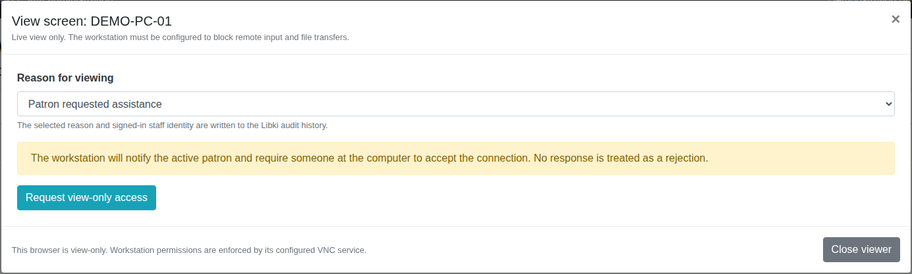
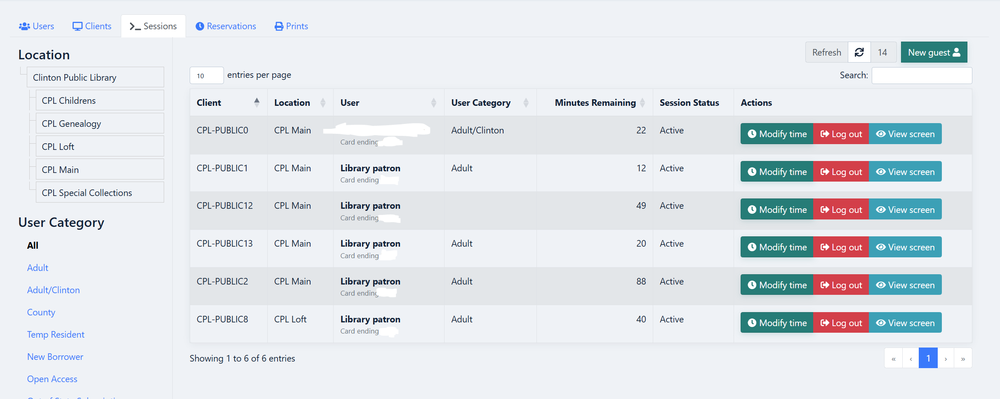
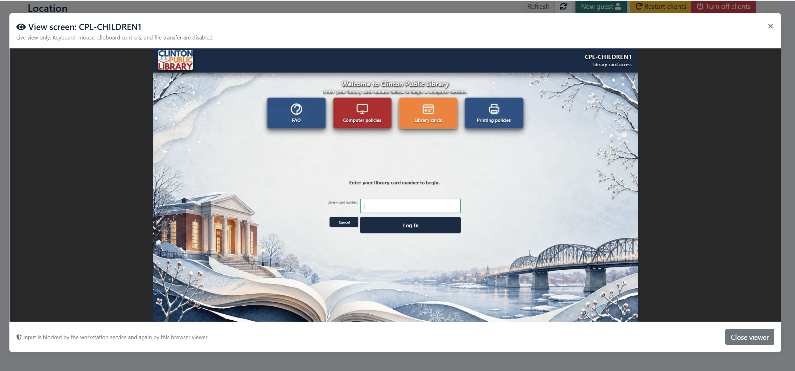

# Libki Mods

Focused, reusable additions for [Libki Server](https://github.com/Libki/libki-server) and [Libki Client](https://github.com/Libki/libki-client).

## Staff Microsoft Entra single sign-on

[Review the Entra contribution](contributions/staff-entra-sso/README.md), including its source patch, setup instructions, dependencies, and tests. This is the same sanitized version submitted in [upstream draft PR #507](https://github.com/Libki/libki-server/pull/507). It adds optional Microsoft sign-in for staff and leaves patron authentication unchanged. Live Entra acceptance testing is still required for this portable export.

## Printing contributions — review drafts

The printing packages have been submitted to the main Libki project as [Part 1 draft PR #508](https://github.com/Libki/libki-server/pull/508) and [Part 2 draft PR #509](https://github.com/Libki/libki-server/pull/509). Both remain drafts for maintainer feedback and further validation; neither has been merged.

| Contribution | Description and code | Screenshots |
| --- | --- | --- |
| Part 1: Staff printing and cash collection | [Review Part 1](contributions/printing/part-1-staff-print-cash/README.md) | [Seven feature screenshots](contributions/printing/part-1-staff-print-cash/SCREENSHOTS.md) |
| Part 2: Companion mobile printing | [Review Part 2](contributions/printing/part-2-mobile-print/README.md) | [Five feature screenshots](contributions/printing/part-2-mobile-print/SCREENSHOTS.md) |

Start with the screenshots. The [printing series overview](contributions/printing/README.md) links to the source, proposed contribution descriptions, validation results, and remaining preparation. Part 2 still needs generic deployment configuration and verification against upstream Libki.

## First feature: staff screen viewer

Help a patron explain a problem by viewing their workstation from the Libki staff page. Staff choose a reason, request access, and wait for someone at the workstation to approve the connection. The browser viewer is view-only.

*Actual patched dialog rendered with fictional workstation data. This is a demonstration, not a screenshot of a patron session.*

- **Staff workflow:** a **View screen** button in the client and session tables, a reason selector, and an embedded noVNC viewer.
- **Authorization and audit:** administrator and instance checks, same-origin request validation, a patron notice when a session exists, and a SCREEN_VIEW_REQUESTED audit event before issuing a token.
- **Gateway:** short-lived signed tokens, one-use replay protection, and a fixed workstation target.
- **Optional Windows client indicator:** a visible banner when an IPv4 connection is established on the configured VNC port.

**Status: technical preview for evaluation.** This first package supports one configured workstation. It includes source patches, configuration examples, documentation, and automated tests. It is not an official Libki release or a ready-to-deploy Windows installer. Workstation consent and input restrictions must be configured and verified at the VNC server; the web application cannot enforce them by itself.

### Screenshots from the deployed setup

*The staff Sessions table places **View screen** beside **Modify time** and **Log out**. Patron names and card-number endings were obscured in the supplied image.*

*The staff viewer displays the public computer's customized Libki login screen. The card-number field is empty.*

These screenshots were supplied from the existing Clinton Public Library deployment. Its multiple enabled workstations, custom branding, login background, and other interface changes are not all included in this one-workstation public preview. The images illustrate appearance; they do not establish endpoint consent settings or replace the acceptance tests.

### Use it

1. Read the [staff walkthrough](docs/STAFF-GUIDE.md).
2. Follow the [installation guide](docs/INSTALL.md), using the exact upstream commits listed there.
3. Review [security boundaries](docs/SECURITY.md) and complete the [acceptance checklist](docs/VALIDATION.md) on an isolated workstation before deployment.

| Component | What is included |
| --- | --- |
| Libki Server | [Server patch](patches/server-viewer.patch): token endpoint and staff UI |
| Libki Client | [Client patch](patches/client-indicator.patch): optional Windows connection indicator |
| WebSocket gateway | [Source and Docker build](gateway/) |
| Deployment | [Examples](examples/), with documentation-only names and addresses |
| Testing | [Regression tests](tests/) |

These changes were developed for the City of Clinton, Iowa, and extracted onto clean public upstream baselines. This repository contains the selected feature, not the City's private Git history or deployment configuration.

### Contributing upstream

This is a standalone contribution package, not a GitHub fork of either upstream project. The server and client patches remain separate so they can become focused pull requests in their respective projects after maintainer feedback and workstation acceptance testing. See the [change description](docs/CHANGE-DESCRIPTION.md).

See [licensing and attribution](LICENSE.md).
