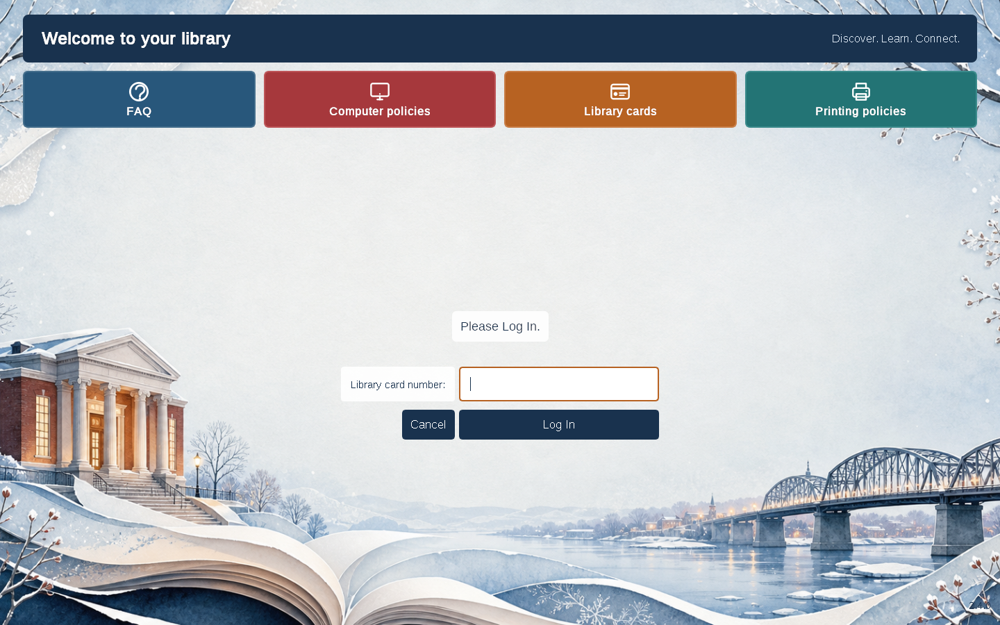
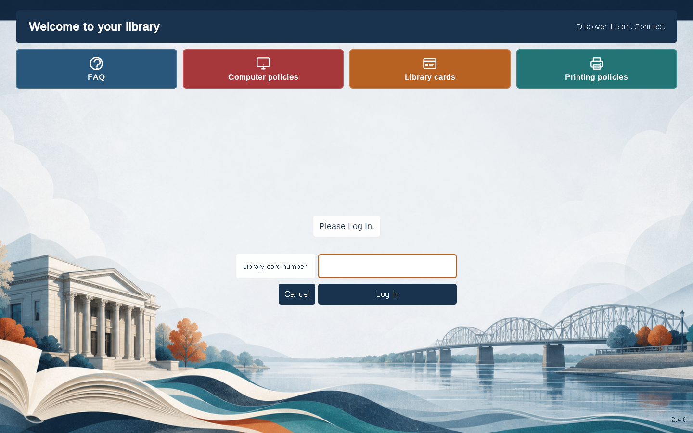
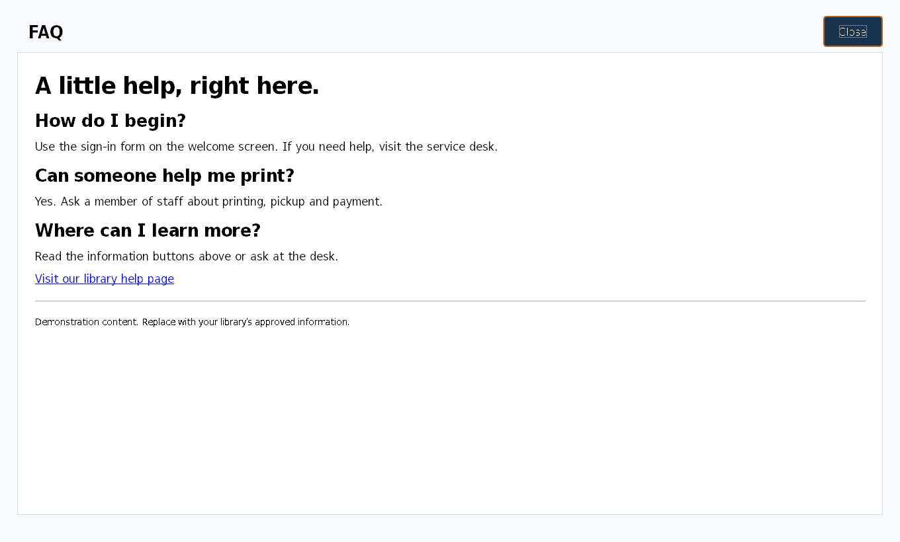
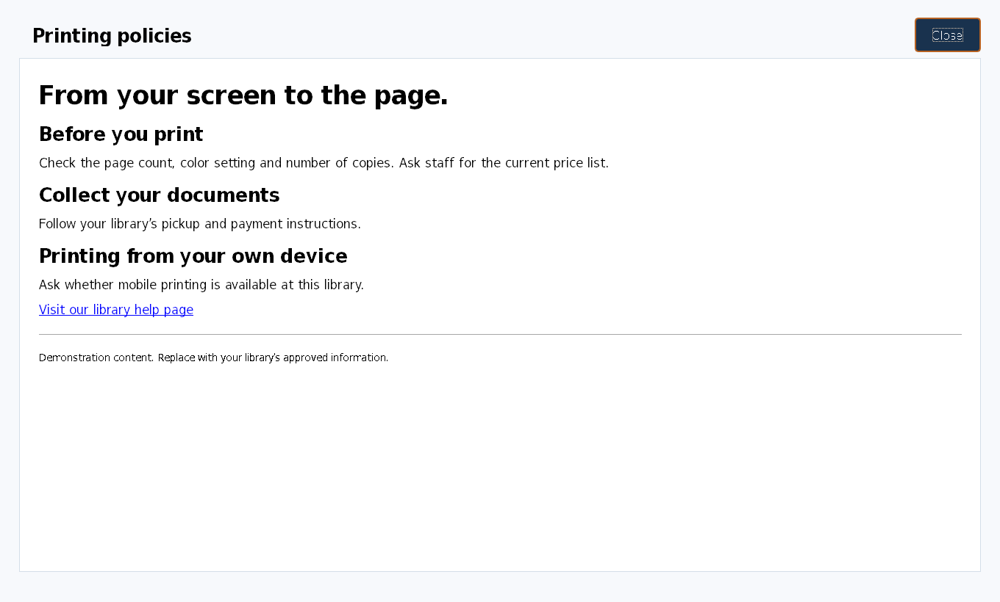

# Configurable Libki client welcome screen

A patron-facing welcome screen with rotating artwork and large information buttons,
adapted from the Clinton Public Library client improvements. Libraries can change
the pictures, rotation interval, labels, website links, and policy text in files
without recompiling the client.

**Status:** source contribution preview for review in libkimods. This package has
not been submitted to or merged into the main Libki client. It is not a Windows
installer. The native Libki login form and authentication remain in place.

## See it

These are captures of the rebuilt native Qt client login window in a test harness,
using demonstration content and no live patron session or server connection.
The harness uses upstream's existing passwordless display option for these views;
this feature does not enable passwordless authentication.

### Winter welcome


### Riverfront rotation


### Garden rotation


### FAQ button


### Printing policies button


## What another library can change

| Setting | Purpose |
| --- | --- |
| `title`, `subtitle`, `logo` | Library welcome text and optional local logo |
| `images` | Ordered list of local pictures |
| `rotation_seconds` | Picture interval; 0 keeps the first image |
| Resource `title` and `icon` | Button labels and local icons |
| Resource `content_file` | Local HTML for FAQs and policies |
| Resource `url` | Optional HTTPS information page instead of local HTML |
| `allowed_origins` | Exact HTTPS website origins permitted in this viewer |
| `style_file` | Optional administrator-maintained Qt stylesheet |

The included four buttons are examples, not fixed topics. Up to eight can be
configured. Local policy pages work offline. No library address, tenant ID,
network endpoint, credentials, patron record, or production policy is required
by this package.

## Apply and build

The patch targets [Libki/libki-client](https://github.com/Libki/libki-client)
revision `cdca236eecce9891715dc1b575cbd01661abd477`.

From a clean checkout of that revision:

```sh
git apply --check /path/to/client-welcome-screen/patches/configurable-welcome.patch
git apply /path/to/client-welcome-screen/patches/configurable-welcome.patch
```

Copy this package's `welcome-example/` directory beside the built client
executable. Use the existing Libki client build procedure; this uses Qt Widgets,
Qt Network and Qt WebKit already present in the upstream project. The patch adds
`welcomescreen.cpp` and `welcomescreen.h` and small integration changes in
`loginwindow.cpp`, `loginwindow.h`, and `Libki.pro`.

Add this section to the **existing client user's Libki INI settings file**.
Keep the existing server, node, and authentication settings:

```ini
[welcome]
config=welcome-example/welcome.ini
```

A relative `config` path is resolved beside the executable. An absolute config
path is also accepted. This is the native client's existing QSettings INI
configuration, not a Libki server setting and not an Entra setting. Run the client
under the same account whose settings you edit.

Edit [welcome-example/welcome.ini](welcome-example/welcome.ini), replace the
sample policy text with your approved library information, and restart the client.
Protect the configuration directory so patrons cannot modify it.

To disable the feature, remove the `welcome/config` setting, or set
`enabled=false` in the welcome INI and restart. Missing/disabled configuration
uses the original upstream layout.

## Configuration details

- All image, logo, icon, policy and stylesheet filenames are relative to the
  welcome INI's folder. Absolute asset paths, escaping `..` paths and symlinks
  outside that folder are rejected.
- PNG/JPEG images are suitable; unreadable pictures are skipped. The first 50
  configured pictures are considered. They fill the window with a centered crop.
  Use suitably sized images rather than very large source artwork.
- Rotation defaults to 180 seconds. Valid values are 0 or 5–86400 seconds.
  Values 1–4 become 5; negative, nonnumeric and larger values use 180.
  With fewer than two valid pictures the timer does not run. It pauses when the
  login surface is hidden and resumes when shown.
- Up to eight resource entries are read. In Qt INI array notation, use `size=4`
  and `1\title=...`, `1\content_file=...`, etc. See the working example.
- A valid `content_file` takes precedence over `url`. HTML is UTF-8 and limited
  to 1 MiB. Local policy HTML cannot load images, scripts or other subresources;
  use headings, paragraphs, lists and links. Missing content displays an
  unavailable message. For offline-first use, keep all four entries local.
- A remote entry uses `url=https://library.example.org/information` and requires
  `allowed_origins=https://library.example.org`. Separate multiple origins with
  commas. An origin has a scheme and hostname, optionally a port, and no path
  beyond `/`, query or fragment. Subdomains are separate origins.
- Only GET requests to configured HTTPS origins are permitted in the new viewer,
  including subresources and redirects. JavaScript, plugins, file access, form
  submission, uploads, pop-up windows, and external browser launching are disabled.
  Cookies are rejected; closing the viewer clears its page/history. Pages that
  need scripts, sign-in or resources from other origins may not render correctly.
- The URL restrictions apply to this new information viewer, **not** the existing
  upstream logo/banner web views or the client's server communications.
- The optional QSS is trusted administrator content, limited to 128 KiB.
  Its own resource references are not sandboxed by the asset-path helper.
  The included stylesheet contains no resource URLs.
- The existing username/password, reservation, login error and server warning
  controls remain native. This change does not introduce a new login method.

## Review and validation

See [VALIDATION.md](VALIDATION.md) for checks and limits,
[PROVENANCE.md](PROVENANCE.md) for source/artwork attribution, and
[tests/](tests/) for the native test harness. Run the harness only in a dedicated
development environment; it creates its own demonstration QSettings identity
and does not construct NetworkClient or run the client's production main().

The pictures and policies are samples. Replace them to match your library.
