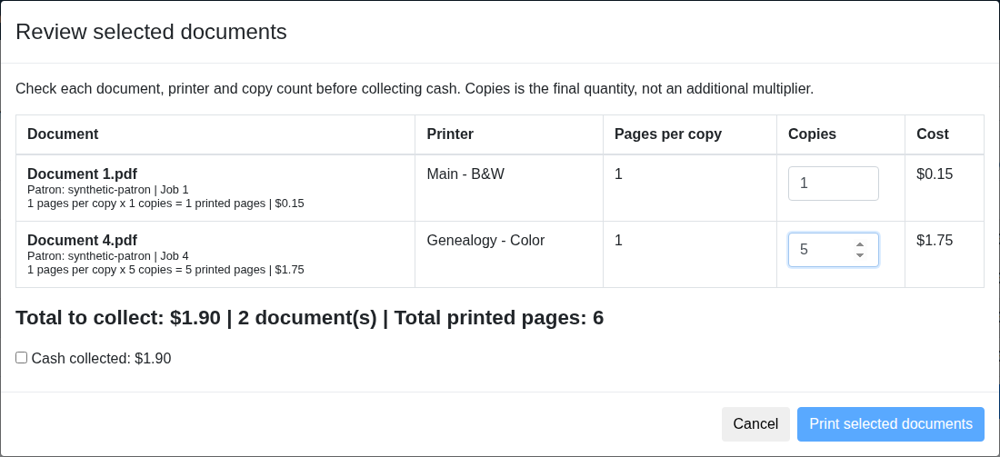

# [Part 1/2] Add staff print selection, copy quantities, and cash review

Submitted as [upstream draft PR #508](https://github.com/Libki/libki-server/pull/508). This is a draft for feedback and further validation, not an official Libki release.

Staff collecting cash for several held print jobs need a single review of the documents, quantities, and amount due. This change lets staff select jobs, adjust copies per job, confirm the combined cash amount, and review each release result. Reprints require a separate review and cash confirmation.

### Included

- Select up to 20 held jobs on the current page and set 1–99 copies per job.
- Recalculate prices and reset cash confirmation when quantities change.
- Release jobs sequentially with separate success, failure, or uncertain outcomes.
- Revalidate prices and location on the server, conditionally claim jobs before submission, and guard repeat release and accounting.
- Focused regression tests and [review documentation](https://github.com/jhansen123456/libki-server/blob/codex/staff-print-cash/docs/staff-cash-printing.md).

### Screenshots

[Seven screenshots with feature captions](https://github.com/jhansen123456/libkimods/blob/b8e7b4e80422a05353e6ad9097d867f4aa73a737/contributions/printing/part-1-staff-print-cash/SCREENSHOTS.md)

The screenshots show the exported UI with fabricated records and intercepted HTTP, not patron records or live printing.

### Validation

Five focused Perl test files passed (47 top-level tests/subtests), including in-memory database acceptance, release, cancellation, and accounting. Browser checks passed for quantities, selection limits, price recalculation, cash reset, reprints, partial failures, repeat-click protection, and expired sessions. Production printers and payments were not used.

The unchanged source was extracted onto upstream 6acf2d1327efcae92fda3509163a9a1da54b99f2. The export passed Gitleaks and targeted disclosure checks; no private Git history, production configuration, credentials, or patron documents are included.

### Draft review boundaries

Staff release now requires POST and cash confirmation. CUPS release is gated by `staff_print_release: enabled` in printer configuration. Compatibility with account payments, public self-service printing, external API callers, and the opt-in behavior needs review before general deployment. Print-system acceptance does not confirm physical output.

This is Part 1 of two separate printing contributions. It can review existing held jobs without the proposed companion mobile service. Maintainer feedback on the API and payment-flow design is welcome.

