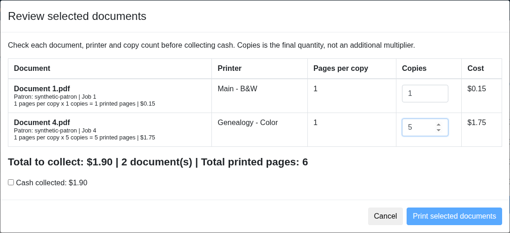

# Part 1: Staff print selection and cash collection

**Submitted as [upstream draft PR #508](https://github.com/Libki/libki-server/pull/508).** This is the first contribution in a two-part printing series. It remains a draft and has not been merged.

## What staff gains

- Select up to 20 held documents on the current page.
- Review a combined cash total and printed-page count.
- Set 1–99 copies for each selected job and recalculate its price.
- Confirm the displayed cash amount before release; quantity changes reset that confirmation.
- Review each release result, including failed or uncertain submissions.
- Request an additional reprint through an explicit review and payment confirmation.

Supporting server changes include price revalidation, location checks, conditional job claiming, accounting and duplicate/reprint safeguards. Acceptance by the print system does not confirm physical output.

## Files and scope

The changes directory contains changed files only. Apply staff-pay-print.patch to a clean upstream Libki/libki-server checkout at commit 6acf2d1327efcae92fda3509163a9a1da54b99f2. It contains no City Git history or deployment settings.

Part 1 does not require the Part 2 mobile upload service to demonstrate staff selection and cash review with existing held jobs. Part 2 is a [separate draft contribution](https://github.com/Libki/libki-server/pull/509).

## Review before general deployment

Review compatibility with existing account payments, public self-service printing and external API callers. Staff release now requires POST and cash confirmation; CUPS release is gated by staff_print_release: enabled in printer configuration. Confirm this opt-in behavior is appropriate for upstream before presenting it as a general release.

## Screenshots and validation

See [seven feature screenshots](SCREENSHOTS.md), [validation](VALIDATION.md) and [draft pull request description](PR-DRAFT.md).

## Preview

[View every feature screenshot](SCREENSHOTS.md).
