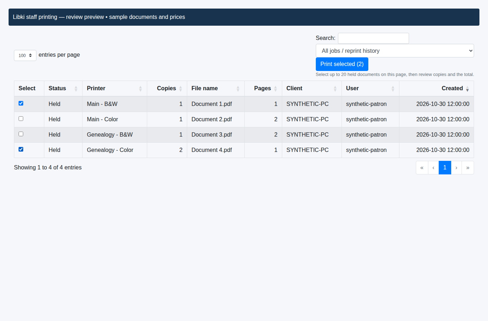
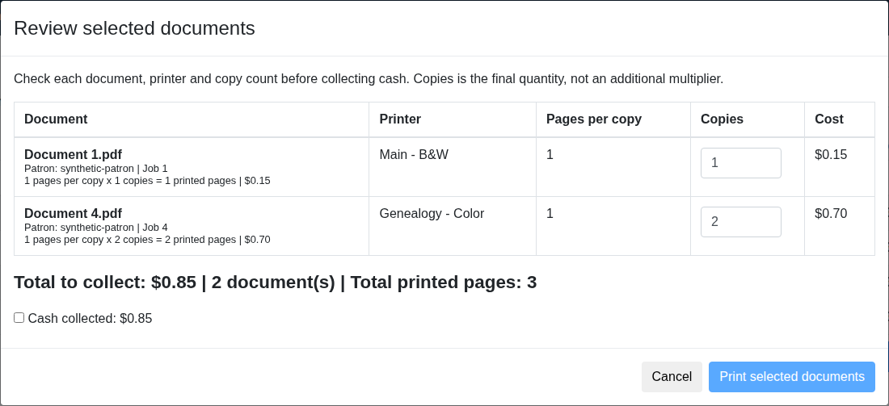
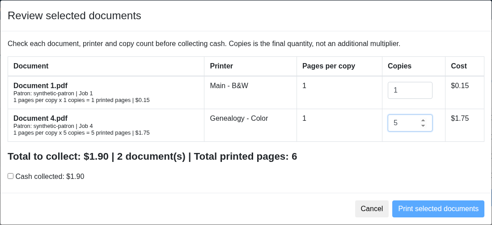
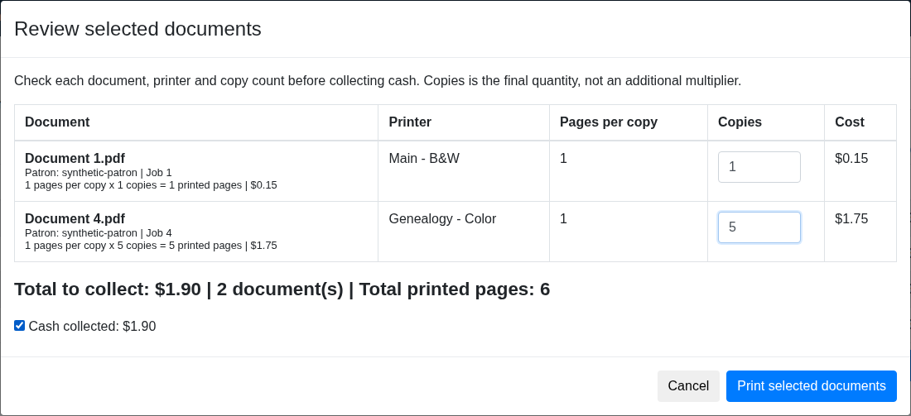
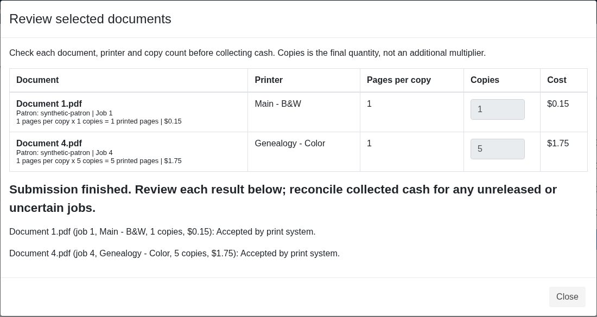
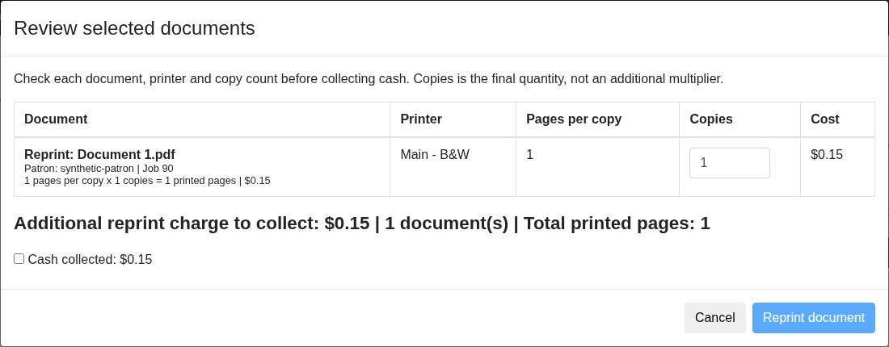
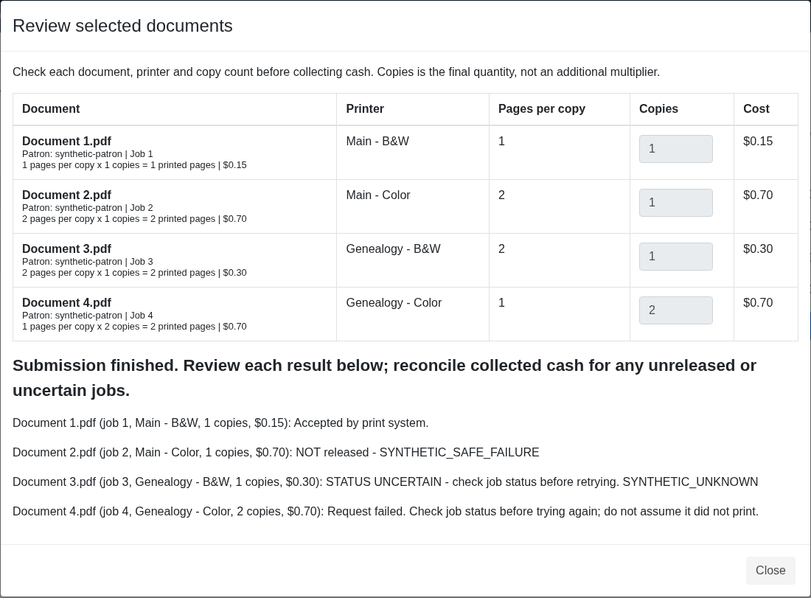

# Part 1 — Staff printing and cash collection

Actual exported interface captures using sample records. No live patron information or production printing. Library branding is retained with permission.

## 1. Select several held documents

Two sample jobs selected together; selection is capped at 20.

## 2. Combined cash total

Review each job and the total before collecting payment.

## 3. Change copies and recalculate

Changing one document to five copies updates its price and the total.

## 4. Confirm cash collected

Release becomes available after staff confirms the displayed amount.

## 5. Review release results

Accepted results indicate acceptance by the print system.

## 6. Explicit additional reprint

Reprints have their own review and payment confirmation.

## 7. Handle partial and uncertain results

Simulated failures show which jobs need staff attention; no automatic resubmission.

