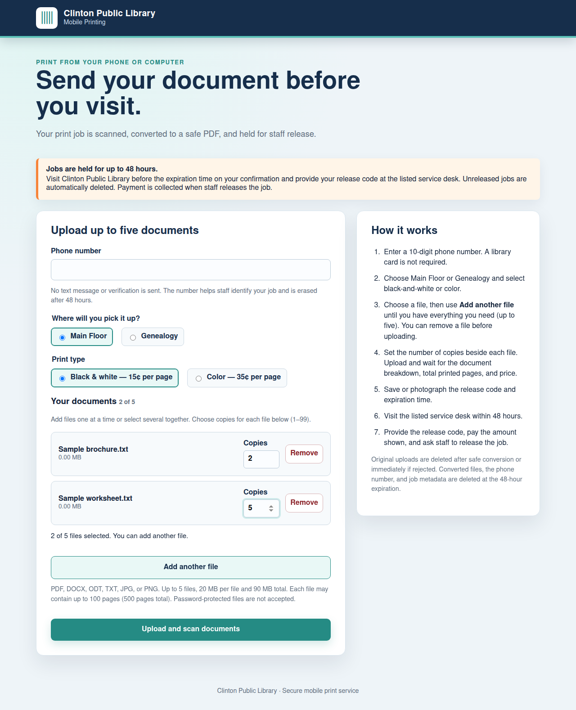

# [Part 2/2] Propose companion mobile printing with guest uploads

Submitted as [upstream draft PR #509](https://github.com/Libki/libki-server/pull/509). This is a draft for feedback and further validation, not an official Libki release.

This companion service lets guests upload documents from a phone or computer without a library card, choose copies for each file, receive a release code and amount due, and pay staff at pickup. It adds a particular guest-upload and staff-pickup workflow alongside Libki's existing web printing.

### Included

- Add documents incrementally or together, up to five; retain quantities and remove files before submission.
- Choose per-file copies, pickup location, and black-and-white or color printing.
- Conversion/scanning workers, a PDF bundle, an authenticated held-job adapter, and expiry cleanup.
- A release-code page with document breakdown, printed-page count, amount due, and pickup instructions.
- Sanitized source, Dockerfiles, focused tests, and readiness notes under `contrib/mobile-print`.

This directory is proposed as a companion service for review; it is not wired into the standard server build or deployment. Feedback on whether it belongs here or in a separate companion repository is welcome.

### Screenshots

[Five screenshots with feature captions](https://github.com/jhansen123456/libkimods/blob/b8e7b4e80422a05353e6ad9097d867f4aa73a737/contributions/printing/part-2-mobile-print/SCREENSHOTS.md)

Screenshots use fabricated records and sample documents. No patron uploads or production credentials are included.

### Validation

Twelve focused Python tests passed; one real-qpdf merge fixture test was skipped. Browser checks passed for incremental selection, retained quantities, removal, five-file limits, canceled selection, filename escaping, phone layout, and multipart submission. Test containers had networking disabled. The source is unchanged from the reviewed libkimods package and the outbound submission passed a fresh Gitleaks scan.

### Why this is a draft

This is Part 2 of the printing proposal, intended to use [Part 1's staff cash-review workflow](https://github.com/Libki/libki-server/pull/508). Its adapter has not been verified against stock upstream Libki intake. Generic deployment configuration, configurable prices and locations, and a clean build plus end-to-end conversion/intake/release test remain required. TLS, scanning/conversion isolation and expiry scheduling also need deployment validation. See [the preparation list](https://github.com/jhansen123456/libki-server/blob/codex/mobile-print-companion/contrib/mobile-print/PREPARATION.md).

Phone numbers identify jobs but are not verified identity and do not provide SMS. Per-file copies are expanded into one PDF bundle; raising the held job's copies at the staff desk repeats that entire bundle. Reserved `.invalid` endpoints are placeholders, not operational defaults.

This contribution is offered for design and implementation review, not as an install-ready release. No private Git history, City network settings, secrets, databases, logs, or patron documents are included.
