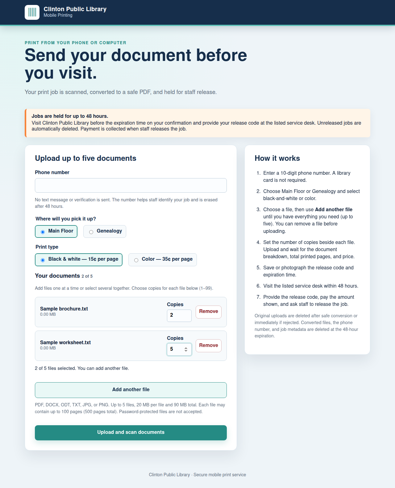

# Part 2: Companion mobile printing service

**Published here for review. Not submitted to the main Libki project.** Proposed after Part 1 is published. Part 2 has not yet been submitted, approved or merged.

This service lets a patron upload documents from a phone or computer without a library card, receive a release code and amount due, then pay staff at pickup. Libki already provides web uploads and printing; this contribution adds our companion service and guest workflow.

## What patrons gain

- Enter a phone number to help identify a job; this is not verified identity or an SMS service.
- Add files one at a time or together, up to five, without losing earlier selections.
- Remove a document before submission and choose 1–99 copies per file.
- Choose a pickup location and black-and-white or color printing.
- Receive a document breakdown, total printed pages, amount due and release code.
- Use the same form on a phone.

The service includes scanning/conversion workers, an authenticated adapter and expiry cleanup. Its intended retention is 48 hours. Original document names are not retained in the server-side document summary.

## How it relates to Part 1

The adapter submits prepared documents as held Libki jobs. Staff then reviews and releases them using the Part 1 workflow. This snapshot is not evidence that the adapter works unchanged with stock upstream Libki. Verify the intake path, guest identification and routing before giving other libraries installation instructions.

Per-file quantities are expanded into one PDF bundle, with bundle copies set to one. Raising that held job's copies at the staff desk repeats the complete bundle. Explain this explicitly in installation and staff documentation.

## Files and readiness

The source directory contains the sanitized companion-service source, existing Dockerfiles and focused tests. It is a review snapshot, not a drop-in plug-in or a complete deployment kit. Read [PREPARATION.md](PREPARATION.md) for remaining portability and integration work.

Example endpoints use reserved .invalid addresses. Credentials, certificates, production database files, uploaded documents, networking, orchestration and deployment records are excluded. The pictured library branding is retained with permission. Prices, pickup locations and retention are implementation defaults that must be configurable or reconciled before deployment.

## Screenshots and validation

See [five mobile screenshots](SCREENSHOTS.md), [validation](VALIDATION.md) and [draft contribution description](PR-DRAFT.md).

## Preview

[View every feature screenshot](SCREENSHOTS.md).
