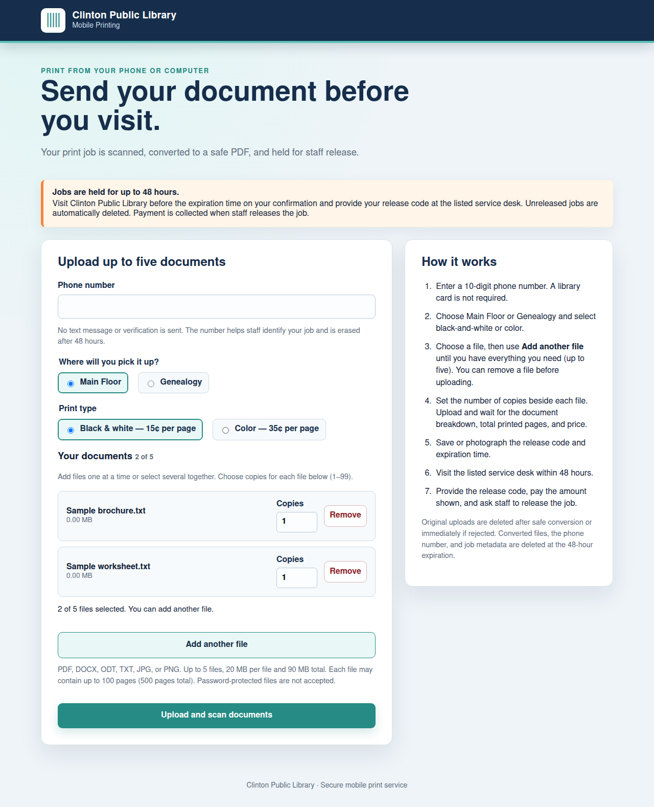
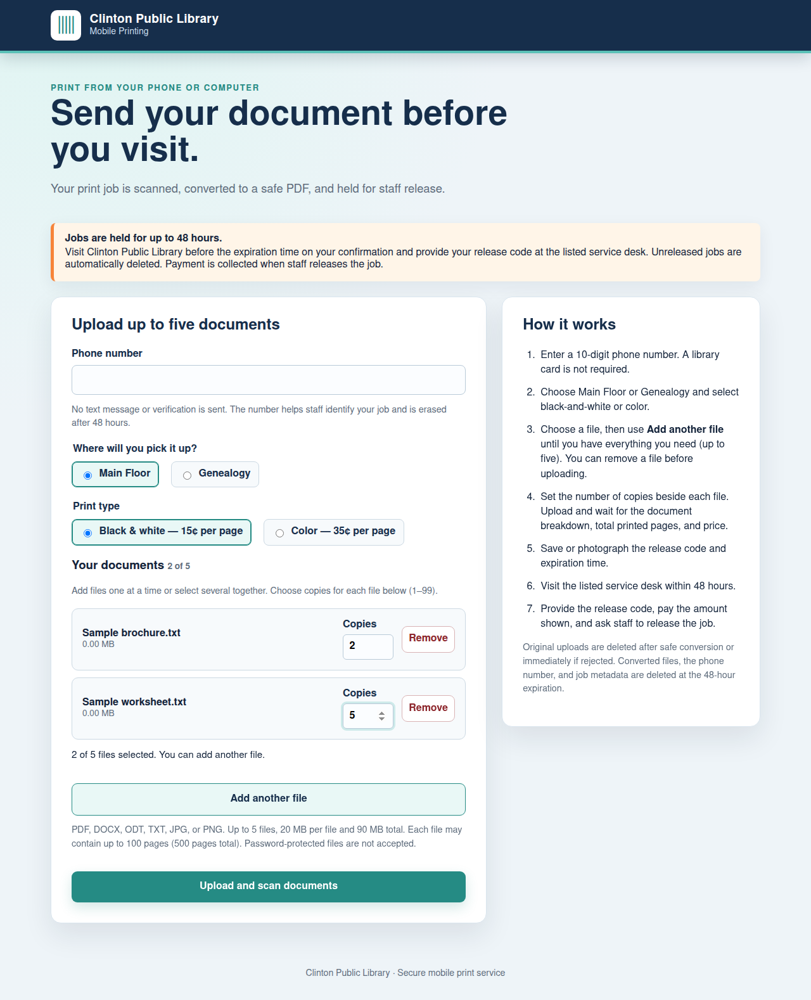
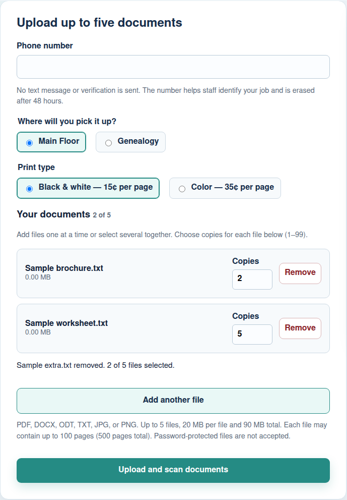
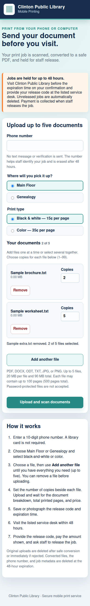
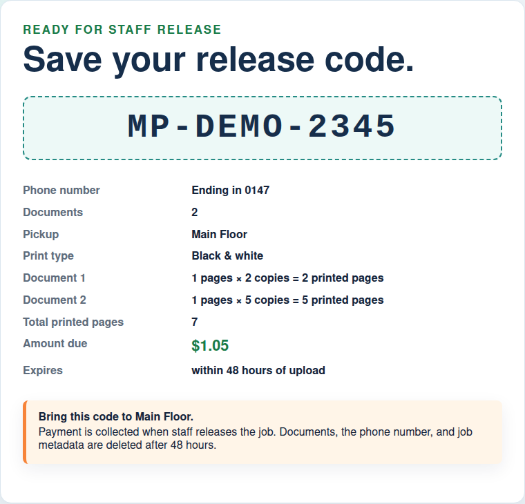

# Part 2 — Mobile printing

Actual exported interface captures using sample records. No live patron information or production printing. Library branding is retained with permission.

## 1. Add mobile documents incrementally

Add one file or several without replacing the earlier selection.

## 2. Choose copies for each mobile file

Separate quantities for two sample documents.

## 3. Remove a document before upload

An extra sample document was removed; the other quantities remain.

## 4. Use the picker on a phone

The same form rendered at a narrow phone viewport.

## 5. Save the release code and total

A fabricated confirmation shows document quantities, amount due and pickup instructions.

