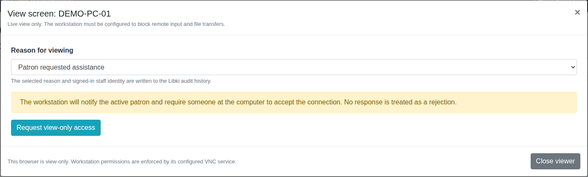
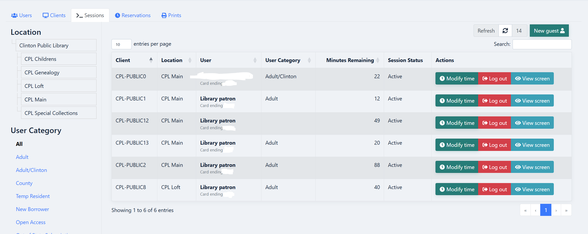
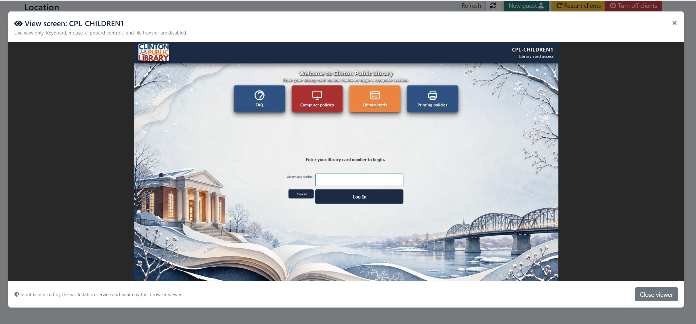

# Staff walkthrough

The administrator first enables the feature for a workstation and configures its VNC service to require local approval.

1. On the staff page, find the workstation in **Clients** or **Sessions** and select **View screen**. The button appears only for the configured workstation.
2. Select the reason for the request. Every reason uses the same view-only, local-approval workflow.
3. Select **Request view-only access**. Libki records the request and queues a notice for the active patron session.
4. Ask the person at the workstation to read the VNC approval prompt. They may accept or reject it. With the required endpoint settings, no response rejects the connection.
5. After acceptance, use the live screen to talk the patron through the problem. Staff continue communicating with the patron; keyboard and mouse control stay at the workstation.
6. Select **Close viewer** when finished. This closes the browser connection. Closing during startup also cancels that viewer attempt.

This image is the actual patched request dialog rendered with fictional data. It shows the proposed public version, not a live City workstation. Endpoint approval dialogs and the Windows indicator are not pictured here.

## Screenshots from the deployed setup

### Finding the View screen button

The **View screen** action appears beside **Modify time** and **Log out** in each enabled workstation's row. The supplied screenshot has patron names and card-number endings obscured.

### Seeing the public computer's screen

The public computer shows its customized Libki login page; the staff member sees that same screen inside the viewer window. The library-card input is empty in this example. **Close viewer** ends the browser connection.

These are screenshots supplied from the existing Clinton Public Library deployment, rather than the synthetic preview dialog above. The deployed version enables multiple workstations and includes custom branding, a login background, and other interface changes beyond this public package. The preview currently supports one configured workstation. Neither screenshot demonstrates the approval prompt or the optional Windows connection indicator, and neither verifies endpoint security settings.

## What the patron sees

If a Libki patron session exists, the client receives a notice explaining the request and reason. The independently configured VNC service presents its accept/reject prompt.

If the optional Windows indicator is enabled, an established IPv4 connection on the selected VNC port shows **SCREEN VIEW CONNECTION**. It can appear while approval is pending: it detects a connection, not successful authentication or consent. If its status check fails, it displays **SCREEN VIEW STATUS UNAVAILABLE**; that warning does not block VNC.

## Adding screenshots

Store approved PNG files in **docs/images/**, then reference them with relative Markdown links:

~~~markdown

~~~

For a real screenshot, use a demonstration workstation and a harmless sample application. Keep patron names, card numbers, email, documents, browser tabs, private infrastructure hostnames, network addresses, credentials, and access tokens out of the frame. Public-facing workstation labels and library branding may be included when intentionally approved for publication. Inspect the image and its metadata before committing it; deleting a file later does not remove it from Git history.

Useful images are the **View screen** button, this request dialog, the workstation approval prompt, and the viewer displaying a demo screen. Describe each image with a short caption and accessible alt text. Label demonstration images clearly.
